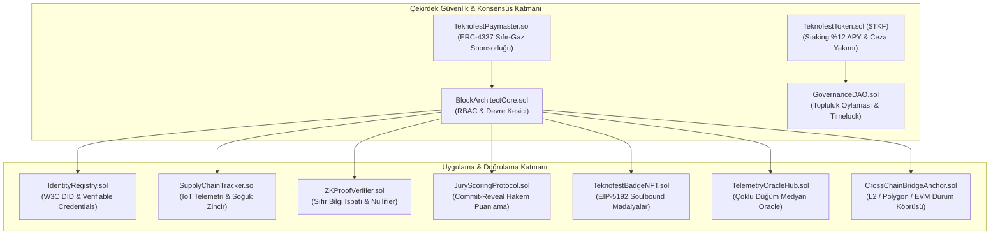

# 🔗 Block-Architect-TR: TEKNOFEST Kurumsal Blokzinciri Referans Mimarisi

<p align="center">
  
  
  
  
  
  
  
</p>

<p align="center">
  
</p>

---

## 📌 Proje Vizyonu ve Genel Bakış
**Block-Architect-TR**, TEKNOFEST Blokzinciri Yarışması standartlarında tasarlanmış; **Sıfır Güven (Zero Trust Architecture)** prensipleri üzerine inşa edilen kurumsal düzeyde bir blokzinciri, merkeziyetsiz kimlik (DID/SSI), sıfır bilgi ispatı (ZK-Proof), anti-collusion hakem heyeti konsensüsü, Soulbound NFT başarı sertifikasyonu (EIP-5192), dağıtık Bizans hata toleranslı telemetri oraclesı, ERC-4337 sıfır-gas sponsorluğu (Paymaster), L2 durum köprüsü ve akıllı tedarik zinciri referans platformudur.

Türkiye'nin **Milli Teknoloji Hamlesi** hedefleri doğrultusunda geliştirilen bu mimari; yüksek ölçeklenebilirlik, gizlilik korumalı doğrulama, manipülasyonsuz jüri puanlaması, bağımsız güvenlik denetlenebilirliği ve görev kritik IoT telemetri mühürleme yeteneklerini bir araya getirir.

---

## 🏛️ 11'li Akıllı Sözleşme Mimarisi ve Ekosistem



### 1. Çekirdek Güvenlik Protokolü (`BlockArchitectCore.sol`)
* **Rol Tabanlı Erişim Kontrolü (RBAC):** `DEFAULT_ADMIN_ROLE`, `OPERATOR_ROLE` ve `AUDITOR_ROLE` ile yetki ayrımı.
* **Acil Durum Devre Kesicisi (Circuit Breaker):** Beklenmedik acil durumlarda `emergencyPause()` ile sistemi dondurma ve güvenle yeniden başlatma.
* **Toplu İşlem Verimliliği:** Merkle ağacı kökleri ile gas optimizasyonlu toplu işlem mühürleme.

### 2. Merkeziyetsiz Kimlik - Self-Sovereign Identity (`IdentityRegistry.sol`)
* **W3C DID v1.0 Standardı:** `did:teknofest:2025:[kategori]:[id]` formatında takım, öğrenci, cihaz ve düğüm kimlikleri.
* **Doğrulanabilir Başarı Belgeleri (VC):** Hakem heyetlerinin yarışmacı takımlara şeffaf, zaman damgalı ve kriptografik başarı belgeleri vermesi.

### 3. Akıllı Tedarik Zinciri & Soğuk Zincir IoT Telemetrisi (`SupplyChainTracker.sol`)
* Görev kritik aviyonik donanımlar, bataryalar ve sensör paketlerinin uçtan uca nakliye takibi.
* Sıcaklık, nem ve GPS koordinatlarının SHA3/Keccak-256 kriptografik mühürleri ile anlık doğrulanması.

### 4. Sıfır Bilgi İspatı & Gizlilik Motoru (`ZKProofVerifier.sol`)
* T.C. Kimlik veya ham sensör verisini ifşa etmeden Merkle üyelik doğrulaması.
* Kriptografik körleme faktörlü Pedersen aralık kanıtları ($min \le v \le max$).
* Çift harcamayı ve kimlik mükerrerliğini önleyen tek kullanımlık **Nullifier** mimarisi.

### 5. TEKNOFEST Hakem Heyeti Puanlama Konsensüsü (`JuryScoringProtocol.sol`)
* Hakemlerin birbirlerinin notlarını görmesini ve puan manipülasyonunu engelleyen **Commit-Reveal şeması**.
* Mimariden sunuma 5 kategorili ağırlıklı rubrik değerlendirmesi ve akıllı sözleşme onaylı derece tescili.

### 6. Soulbound Başarı Madalyaları & Nişanları (`TeknofestBadgeNFT.sol`)
* **EIP-5192 Devredilemez Sertifika:** Dereceye giren takımlara verilen altın, gümüş, bronz madalyaların ve hakem heyeti nişanlarının ikinci el satışı ve transferi akıllı sözleşme düzeyinde kilitlidir.
* Blokzincir üzerinde kalıcı tescil edilen dijital başarı portfolyosu.

### 7. Dağıtık IoT Aviyonik Telemetri Oracle Hub (`TelemetryOracleHub.sol`)
* Trabzon, Samsun, Ankara ve İstanbul gibi farklı yer istasyonlarından gelen çoklu sensör verilerini toplar.
* **Bizans Hata Toleranslı Medyan:** Aykırı değerleri (outlier) ve sensör manipülasyonlarını otomatik filtreleyerek hatasız konsensüs telemetrisi üretir.

### 8. Hesap Soyutlama & Sıfır-Gaz Sponsorluğu (`TeknofestPaymaster.sol`)
* **ERC-4337 Standardı:** Yarışmacı öğrenci takımlarının gas ücreti ödemeden işlem yapabilmesi için kurumsal paymaster havuzundan sponsorluk sağlar.
* Günlük kota ve adres bazlı beyaz liste kontrolleri ile bütçe suistimalleri engellenir.

### 9. Çapraz Zincir Durum Köprüsü (`CrossChainBridgeAnchor.sol`)
* TEKNOFEST yerel alt ağı (Subnet / Rollup) ile Polygon (#137) veya Ethereum (#1) arasında durum ve tescil aktarımı.
* Eşik multi-sig relayer doğrulaması ve monotonik nonce replay koruması.

### 10. Ekosistem Tokenomiği ve Staking (`TeknofestToken.sol`)
* Sabit 10,000,000 arz tavanına sahip `$TKF` ERC-20 hizmet jetonu.
* Doğrulayıcı düğümler için yıllık %12 getiri oranlı (APY) Proof-of-Stake modeli ve kötü niyet cezası (slashing).
* Hakem heyeti ve değerlendiriciler için tek tıkla testnet token talep musluğu (Faucet).

### 11. DAO ve Topluluk Yönetişimi (`GovernanceDAO.sol`)
* Şeffaf teklif oluşturma, oy kullanma, kuorum takibi ve 24 saatlik timelock icra koruması.

---

## ⚡ Hızlı Başlangıç (Quickstart)

### 1. Depoyu Klonlayın
```bash
git clone https://github.com/bahattinyunus/teknofest_blokzincir.git
cd teknofest_blokzincir
```

### 2. Bağımsız Test Süitini Çalıştırın (30/30 Başarılı)
Dahili test koşucusu harici paket indirmesi gerektirmeden saniyeler içinde çalışır:
```bash
node test/runner.js
# veya
npm test
```

### 3. Uçtan Uca Canlı Simülasyon Senaryosunu Başlatın (11 Sözleşme Entegre)
```bash
node src/cli/cli.js demo
# veya
npm run demo
```

### 4. REST API ve Oracle Sunucusunu Başlatın
```bash
node src/api/server.js
# veya
npm start
```
* **Sağlık Kontrolü:** `http://localhost:3000/api/v1/health`
* **Canlı Metrikler:** `http://localhost:3000/api/v1/metrics`
* **Liderlik Tablosu:** `http://localhost:3000/api/v1/jury/leaderboard`
* **Soulbound NFT Vitrini:** `http://localhost:3000/api/v1/nft/badges`
* **Oracle Telemetri:** `http://localhost:3000/api/v1/oracle/consensus`
* **Güvenlik Denetimi:** `http://localhost:3000/api/v1/security/audit`

### 5. Web3 Yönetim Konsolunu Görüntüleyin (12 Sekmeli Arayüz)
`frontend/index.html` dosyasını doğrudan herhangi bir tarayıcıda açabilir veya yerel sunucu başlatabilirsiniz:
```bash
npm run serve:frontend
```
> **Not:** Arayüz, MetaMask yüklü olmasa bile yerleşik **Sandbox Mimari Modu** sayesinde tüm sözleşme fonksiyonlarını, cüzdan bakiyelerini, güvenlik simülasyonunu ve grafiklerini eksiksiz simüle eder.

<p align="center">
  
</p>

---

## 📂 Proje Dizin Yapısı

```
teknofest_blokzincir/
├── .github/workflows/       # GitHub Actions otomatik CI/CD test hattı
│   └── ci.yml
├── contracts/               # EVM Uyumlu 11 Akıllı Sözleşme
│   ├── common/              # Modüler güvenlik tabanı (Ownable, Pausable, RBAC, Guard, IERC721)
│   ├── security/            # Reentrancy & Exploit test harness
│   ├── BlockArchitectCore.sol
│   ├── IdentityRegistry.sol
│   ├── SupplyChainTracker.sol
│   ├── ZKProofVerifier.sol
│   ├── JuryScoringProtocol.sol
│   ├── TeknofestBadgeNFT.sol
│   ├── TelemetryOracleHub.sol
│   ├── TeknofestPaymaster.sol
│   ├── CrossChainBridgeAnchor.sol
│   ├── TeknofestToken.sol
│   └── GovernanceDAO.sol
├── docs/                    # Profesyonel Dokümantasyon
│   ├── assets/              # Mimari banner ve arayüz görselleri
│   │   ├── banner.jpg
│   │   └── dashboard_preview.jpg
│   ├── ARCHITECTURE.md      # Detaylı Mermaid mimari diyagramları (11 sözleşme)
│   ├── WHITE_PAPER.md       # Akademik düzeyde teknik White Paper (v3.0)
│   └── API_REFERENCE.md     # SDK ve REST API başvuru kılavuzu
├── frontend/                # 12 Sekmeli Web3 Yönetim & Denetleme Konsolu
│   ├── index.html           # Futuristik Web3 arayüzü
│   ├── app.js               # Canlı blok zincir simülatörü & Web3 köprüsü
│   ├── style.css            # Glassmorphism ve neon tema stilleri
│   └── README.md
├── scripts/                 # Dağıtım ve Veri Tohumlama Betikleri
│   ├── deploy.js            # 11 sözleşmeyi dağıtıp JSON çıktıları üreten betik
│   └── seedData.js          # Kapsamlı demo takımları, ZK, NFT, oracle ve jüri verileri
├── src/                     # Node.js SDK, REST API ve CLI
│   ├── api/server.js        # Hafif REST API & Oracle servisi
│   ├── cli/cli.js           # İnteraktif terminal yönetim aracı (did, zk, jury, nft, oracle, bridge)
│   ├── sdk/BlockArchitectSDK.js # 11 sözleşmeli birleşik JavaScript blokzincir istemcisi
│   ├── utils/crypto.js      # Merkle Tree, ZK Proof, Pedersen, W3C DID fonksiyonları
│   └── main.js              # Kütüphane ana giriş noktası
├── test/                    # Birim ve Entegrasyon Testleri
│   ├── runner.js            # 30/30 Başarılı bağımsız test koşucusu
│   ├── BlockArchitectCore.test.js
│   ├── IdentityRegistry.test.js
│   ├── SupplyChainTracker.test.js
│   ├── ZKProofVerifier.test.js
│   ├── JuryScoringProtocol.test.js
│   └── CrossChainBridgeAnchor.test.js
├── hardhat.config.js        # Hardhat ağ ve Solidity derleme ayarları
├── package.json             # Bağımlılıklar ve çalıştırma komutları
└── README.md                # Proje tanıtım belgesi
```

---

## 👨‍💻 Hazırlayan ve Mimar Hakkında

**Bahattin Yunus Çetin**  
*IT Architect | Blokzincir Araştırmacısı*  
Trabzon / Of

Kurumsal teknoloji mimarileri, dağıtık sistemler ve blokzinciri altyapıları üzerine odaklanmış bir bilişim profesyoneli. Türkiye'nin blokzinciri ekosistemini güçlendirmek ve yerli teknolojilerin küresel standartlarda uygulanmasını sağlamak amacıyla topluluğa katkı sunmaktadır.

* **LinkedIn:** [linkedin.com/in/bahattinyunus](https://www.linkedin.com/in/bahattinyunus/)
* **GitHub:** [github.com/bahattinyunus](https://github.com/bahattinyunus)

---

## 📄 Lisans
Bu proje [MIT Lisansı](LICENSE) altında açık kaynak olarak sunulmuştur.

<p align="center">
  
</p>
