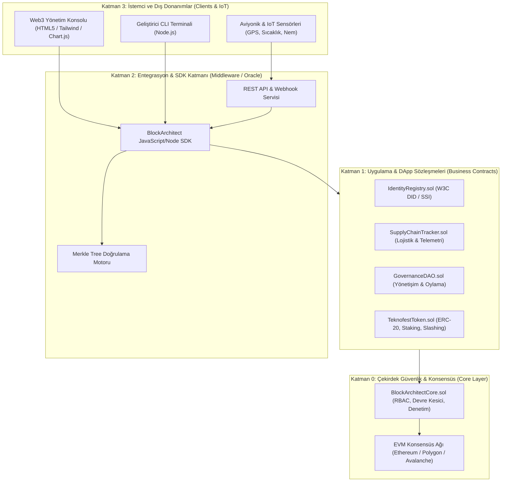
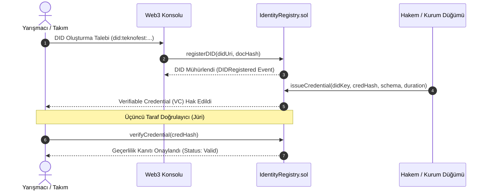
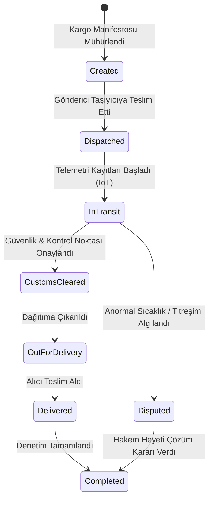
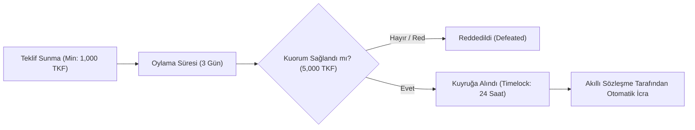

# 🏛️ Block-Architect-TR: Sistem ve Yazılım Mimarisi

Bu belge, **TEKNOFEST Blokzinciri** yarışması standartlarında kurumsal seviyede tasarlanan **Block-Architect-TR** protokolünün sistem mimarisini, katmanlı yapısını ve veri akış diyagramlarını detaylandırmaktadır.

---

## 1. Katmanlı Sistem Mimarisi (Architectural Layers)

Sistem, **Sıfır Güven Mimarisi (Zero Trust Architecture)** prensiplerine dayanarak 4 ana katmana ayrılmıştır:

---

## 2. Merkeziyetsiz Kimlik (DID / SSI) Doğrulama Döngüsü

W3C v1.0 standartlarına uyumlu SSI (Self-Sovereign Identity) mimarisi ile katılımcı takımlar, öğrenciler ve IoT cihazları merkezi sunuculara bağımlı olmadan kriptografik olarak doğrulanır.

---

## 3. Akıllı Tedarik Zinciri ve Soğuk Zincir Durum Makinesi

Yüksek öneme sahip aviyonik, radar ve batarya parçalarının TEKNOFEST yarışma sahasına güvenli nakliyesi için durum makinesi:

---

## 4. DAO Yönetişim ve Timelock Karar Mekanizması

Protokolün yükseltmeleri ve doğrulayıcı düğüm izinleri topluluk tarafından şeffaf bir şekilde oylanır:

---

## 5. Güvenlik ve Defansif Kodlama Önlemleri

1. **Reentrancy Koruması:** Fonksiyonel çağrılarda `nonReentrant` bayrağı ile reentrancy zafiyetleri donanımsal düzeyde engellenmiştir.
2. **Rol Tabanlı Erişim Kontrolü (RBAC):** `DEFAULT_ADMIN_ROLE`, `OPERATOR_ROLE` ve `AUDITOR_ROLE` ile yetki ayrımı sağlanmıştır.
3. **Acil Durum Devre Kesicisi (Circuit Breaker):** Beklenmedik durumlarda sistem `emergencyPause()` ile dondurulabilir, inceleme sonrası `emergencyResume()` ile sürdürülebilir.
4. **Merkle Ağacı Doğrulaması:** Toplu telemetri ve işlem verileri O(log n) karmaşıklığında Merkle kökleri ile zincir üzerinde minimum gas maliyetiyle doğrulanır.
