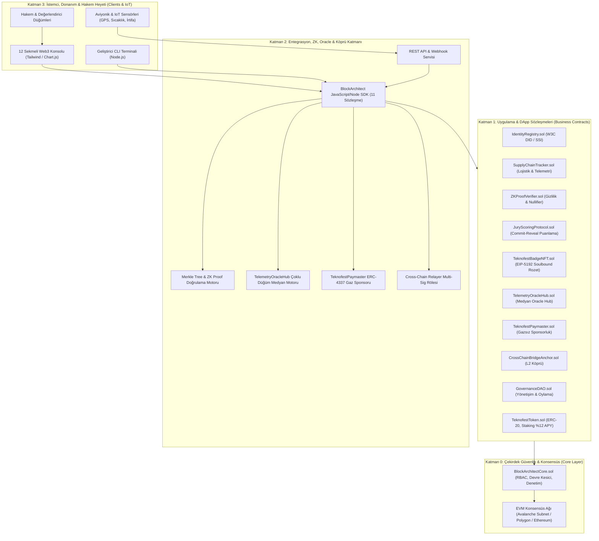
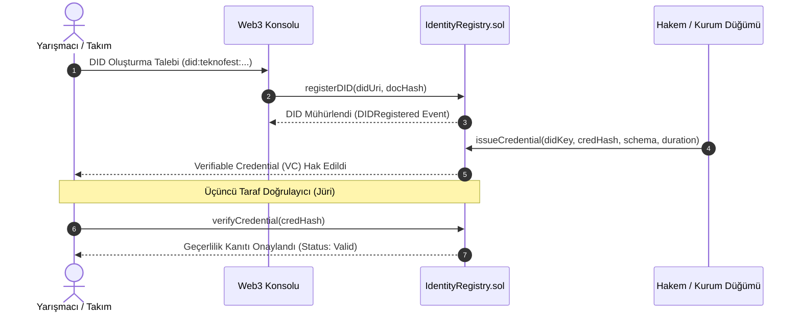
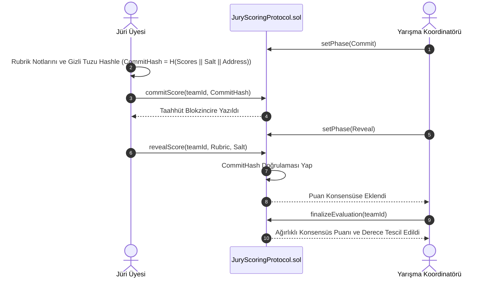
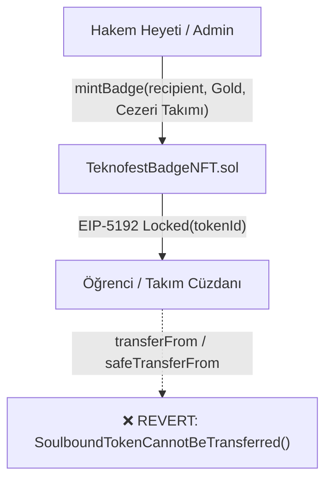
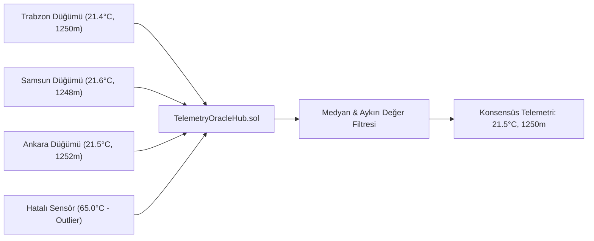
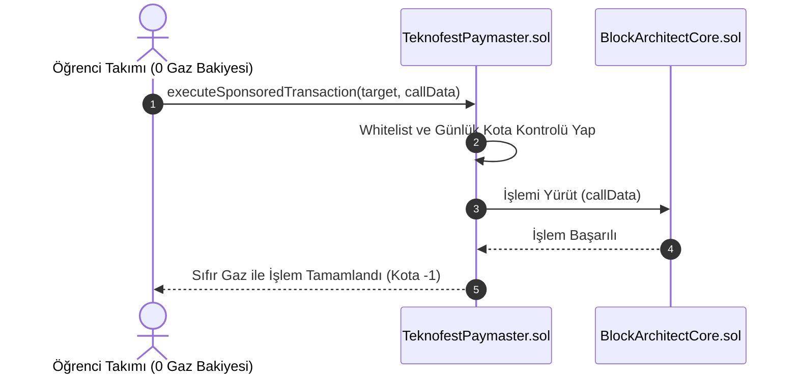
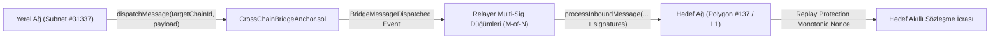

# 🏛️ Block-Architect-TR: Sistem ve Yazılım Mimarisi

Bu belge, **TEKNOFEST Blokzinciri** yarışması standartlarında kurumsal seviyede tasarlanan **Block-Architect-TR** protokolünün sistem mimarisini, 11 akıllı sözleşmeli modüler yapısını ve veri akış diyagramlarını detaylandırmaktadır.

---

## 1. Katmanlı Sistem Mimarisi (Architectural Layers)

Sistem, **Sıfır Güven Mimarisi (Zero Trust Architecture)** prensiplerine dayanarak 4 ana katmana ayrılmıştır:



---

## 2. Merkeziyetsiz Kimlik (DID / SSI) Doğrulama Döngüsü

W3C v1.0 standartlarına uyumlu SSI (Self-Sovereign Identity) mimarisi ile katılımcı takımlar, öğrenciler ve IoT cihazları merkezi sunuculara bağımlı olmadan kriptografik olarak doğrulanır.



---

## 3. Sıfır Bilgi İspatı (Zero-Knowledge) & Nullifier Yaşam Döngüsü

Kişisel veriler (TC No, doğum tarihi) veya gizli aviyonik telemetriler ifşa edilmeden Merkle üyeliği ve Pedersen aralık kanıtları ($min \le v \le max$) doğrulanır:

```mermaid
sequenceDiagram
    autonumber
    actor Participant as Anonim Katılımcı
    participant Verifier as ZKProofVerifier.sol
    participant NullifierRegistry as Nullifier Havuzu

    Participant->>Participant: Merkle Kanıtı ve Nullifier Hesapla (N = H(Secret || Scope))
    Participant->>Verifier: verifyAndConsumeCredential(Root, Leaf, Proof, Nullifier)
    Verifier->>NullifierRegistry: Nullifier Daha Önce Harcandı mı?
    alt Harcanmamış (Geçerli)
        NullifierRegistry-->>Verifier: Temiz (Harcanmadı)
        Verifier->>NullifierRegistry: Nullifier'ı Mühürle (Harcanmış Olarak İşaretle)
        Verifier-->>Participant: İspat Geçerli & İşlem Onaylandı
    else Zaten Harcanmış (Çift Harcama)
        NullifierRegistry-->>Verifier: HATA: NULLIFIER_ALREADY_CONSUMED
        Verifier-->>Participant: İşlem İptal Edildi (Anti-Double-Spend)
    end
```

---

## 4. Hakem Heyeti Anti-Collusion Commit-Reveal Protokolü

Hakemlerin birbirlerinin notlarını görmeden bağımsız değerlendirme yapabilmesi için kriptografik iki aşamalı protokol uygulanır:



---

## 5. Soulbound Başarı Rozetleri (EIP-5192) Mimarisi

Yarışmada dereceye giren takımların elde ettiği madalyalar (`TeknofestBadgeNFT.sol`), geleneksel NFT'lerin aksine devredilemez (soulbound) niteliktedir:



---

## 6. Bizans Hata Toleranslı Telemetri Oracle Hub Mimarisi

Dağıtık uç yer istasyonlarından gelen sıcaklık ve irtifa verileri, aykırı değer filtresinden geçirilerek medyan hesaplanır:



---

## 7. ERC-4337 Hesap Soyutlama & Paymaster Gaz Sponsorluğu

Öğrenci takımlarının işlem maliyetlerini minimize etmek adına gazsız sponsorluk döngüsü:



---

## 8. Çapraz Zincir Durum Köprüsü (Cross-Chain Bridge Anchor)

TEKNOFEST yerel alt ağı (Subnet / Rollup) ile Polygon veya Ethereum ana ağı arasında durum rölesi:



---

## 9. Güvenlik ve Defansif Kodlama Önlemleri

1. **Reentrancy Koruması:** Tüm fonksiyonel dış çağrılarda `nonReentrant` bayrağı ile reentrancy zafiyetleri engellenmiştir (`contracts/security/ReentrancyAttacker.sol` ile test edilip doğrulanmıştır).
2. **Rol Tabanlı Erişim Kontrolü (RBAC):** `DEFAULT_ADMIN_ROLE`, `OPERATOR_ROLE`, `VERIFIER_ROLE`, `JURY_ROLE`, `COORDINATOR_ROLE`, `ORACLE_NODE_ROLE`, `RELAYER_ROLE` ve `BRIDGE_ADMIN_ROLE` ile yetki ayrımı sağlanmıştır.
3. **Acil Durum Devre Kesicisi (Circuit Breaker):** Beklenmedik durumlarda sistem `emergencyPause()` ile dondurulabilir, inceleme sonrası `emergencyResume()` ile sürdürülebilir.
4. **Kriptografik Replay Koruması:** Hem ZK kimliklerinde `nullifier` harcama denetimi hem de çapraz zincir köprüsünde zincir-bazlı `nonce` kontrolü uygulanmıştır.
5. **Soulbound Kilitleme:** EIP-5192 standardına uygun `_beforeTokenTransfer` kancası ile başarı rozetlerinin satışı veya transferi engellenmiştir.
