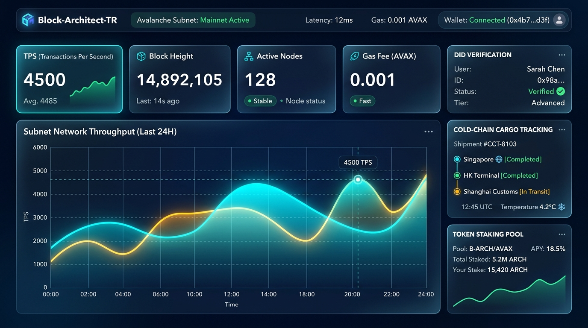

# 🌐 Block-Architect-TR | Web3 Frontend Konsolu

<p align="center">
  
</p>

Bu dizin, **TEKNOFEST Blokzinciri** referans mimarisi için geliştirilmiş 9 sekmeli, tam teşekküllü interaktif Web3 yönetim ve denetleme arayüzünü içerir.

---

## 🚀 Öne Çıkan Özellikler

1. **Çift Modlu Çalışma (Zero-Friction Sandbox + MetaMask)**:
   - Tarayıcıda doğrudan `index.html` dosyasını açarak veya bir yerel sunucuyla anında test edilebilir.
   - MetaMask takılı olmasa bile tüm 8 akıllı sözleşme akışı (DID, Tedarik Zinciri, ZK, Jüri, Köprü, DAO, Staking, Musluk) dahili simülatör üzerinden eksiksiz çalışır.
   - MetaMask bağlı olduğunda gerçek Web3 sağlayıcısı ile etkileşime girer.

2. **Merkeziyetsiz Kimlik (DID / SSI) Yönetimi**:
   - W3C v1.0 DID standartlarına uygun kimlik kaydı (`did:teknofest:2025:...`).
   - Takım, öğrenci, doğrulayıcı düğüm ve IoT cihazları için dijital kimlik üretimi.

3. **Akıllı Tedarik Zinciri ve Soğuk Zincir IoT Telemetrisi**:
   - Görev kritik aviyonik parçaların uçtan uca sevkiyat takibi.
   - Sıcaklık, nem ve GPS koordinatlarının kriptografik telemetri mühürleri.

4. **Sıfır Bilgi İspatı (ZK-Proof) Stüdyosu**:
   - Gizli iddiaların Merkle üyelik doğrulaması ve tek kullanımlık Nullifier takibi.
   - Hassas sensör telemetrileri için Pedersen aralık kanıtı simülatörü.

5. **Hakem Heyeti (Jury) Puanlama & Liderlik Tablosu**:
   - İki aşamalı **Commit-Reveal** şeması ile manipülasyonsuz jüri notu verme.
   - Ağırlıklı rubrik puanları (Mimari, Güvenlik, İnovasyon, Uygulama, Sunum) ve dinamik liderlik tablosu.

6. **Çapraz Zincir Durum Köprüsü (Cross-Chain Bridge)**:
   - Yerel alt ağdan Polygon, Ethereum ve Avalanche ağlarına durum sevk simülasyonu ve relayer çoklu imza denetimi.

7. **DAO Yönetişim ve Oylama Protokolü**:
   - Topluluk teklifleri oluşturma, Evet/Hayır oylamaları, kuorum ve timelock izleme.

8. **TKF Tokenomics, Staking ve Faucet**:
   - Yıllık %12 APY getiri oranlı validator staking simülatörü.
   - Hakem heyeti ve değerlendiriciler için tek tıkla testnet token talep musluğu.

---

## 💻 Nasıl Çalıştırılır?

### Yöntem 1: Doğrudan Tarayıcıda Açma
`frontend/index.html` dosyasına çift tıklayarak Chrome, Edge, Brave veya Firefox üzerinde doğrudan açabilirsiniz.

### Yöntem 2: Node.js ile Canlı Sunucu
```bash
npm run serve:frontend
```
veya:
```bash
npx serve frontend
```

### Yöntem 3: Python Hızlı Sunucu
```bash
python -m http.server 8080 --directory frontend
```
Tarayıcınızdan `http://localhost:8080` adresine gidin.
